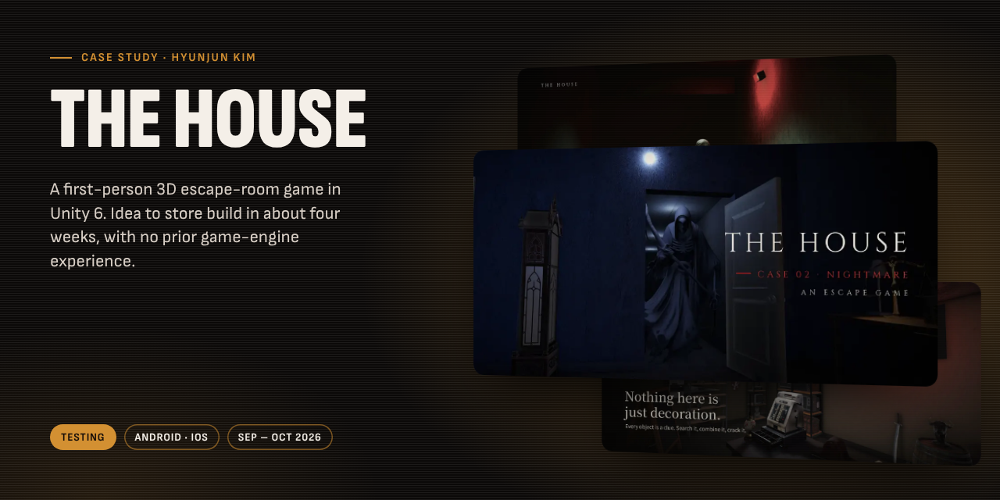
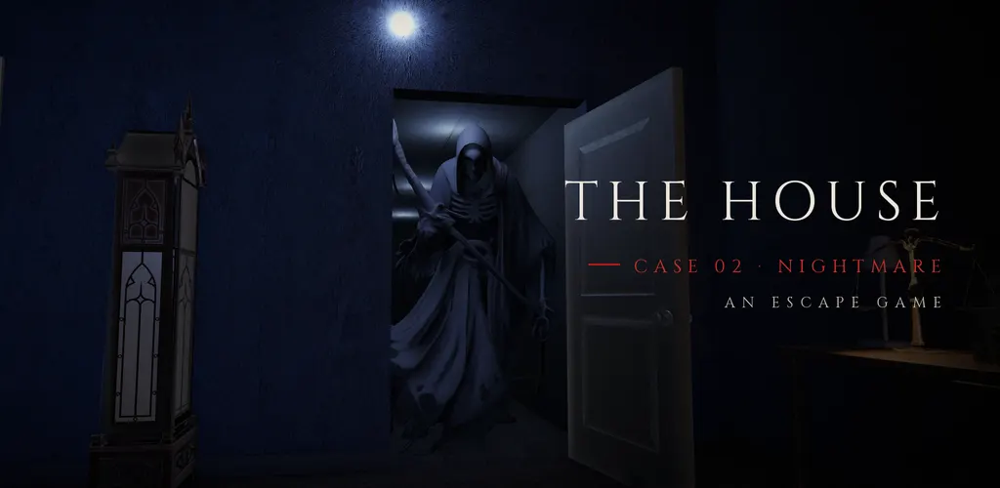
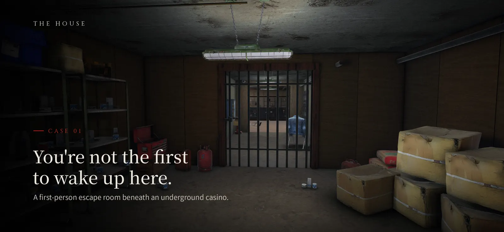
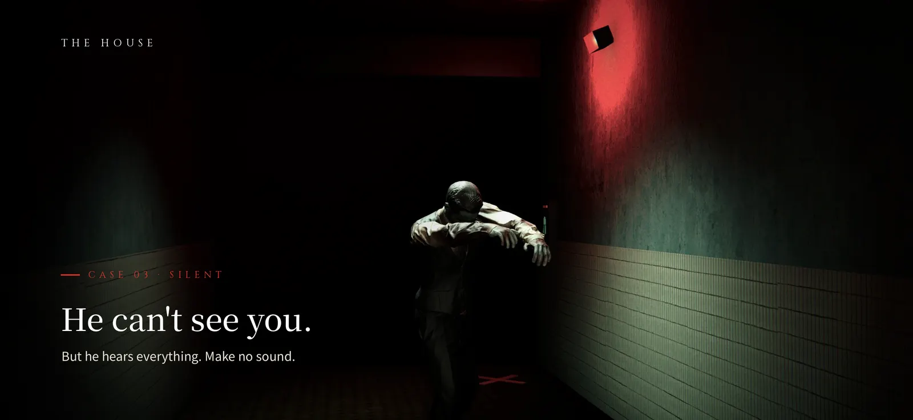
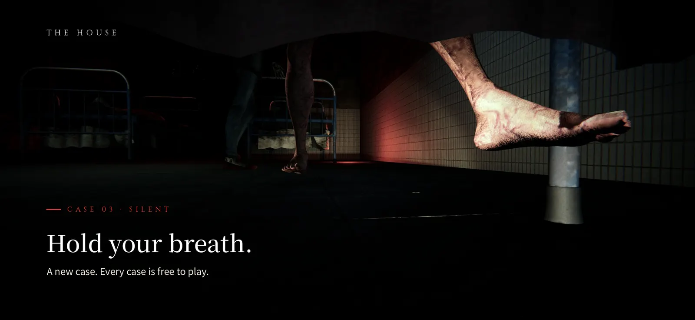
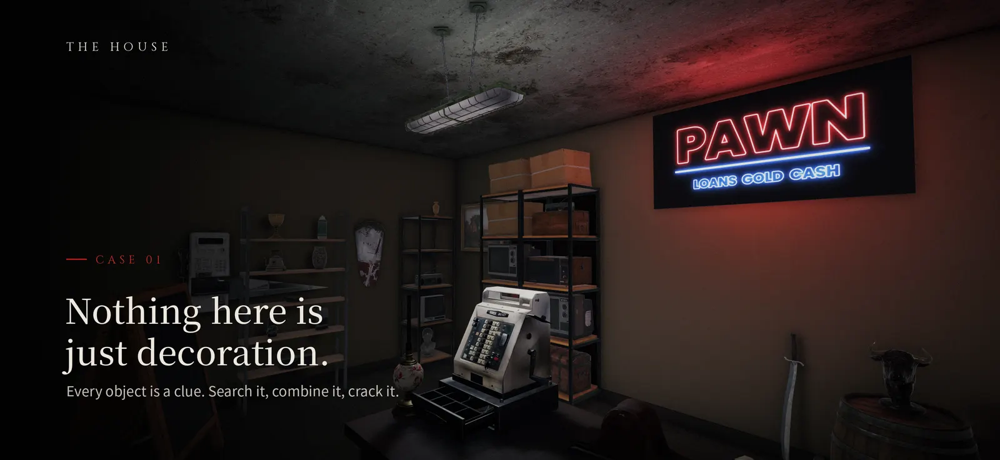
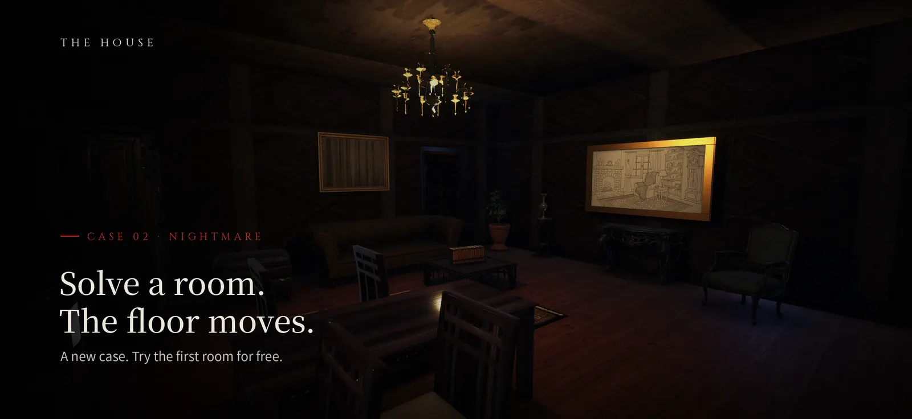
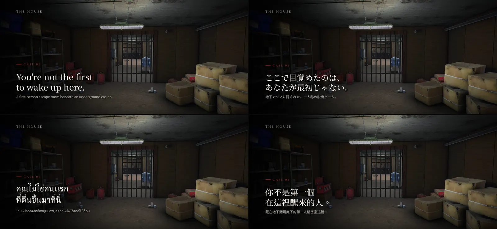
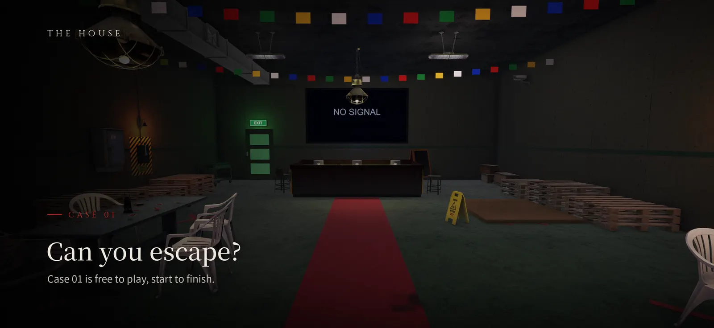
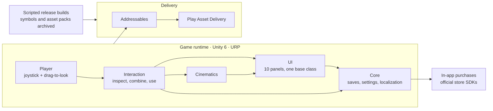

# THE HOUSE

A first-person 3D escape-room game in Unity 6. Idea to store build in about four weeks, with no prior game-engine experience.

**Status:** Testing (Google Play internal test, TestFlight) &nbsp;·&nbsp; **Platforms:** Android · iOS &nbsp;·&nbsp; **Built:** Sep – Oct 2026
 [Full case study](https://hyunjunkim.vercel.app/projects/the-house/)

> [!NOTE]
> This repository is a **case study**, not the source code. The code is private. I'm happy to walk through the codebase live in an interview, or to give a hiring team temporary read access on request.

## The problem

Bring the tension of a real escape room to a phone: free 3D look and movement, puzzles you solve by handling objects, cinematics, and a story told across three cases.

## Screens

|   |   |
|:-:|:-:|
|  |  |
| Store feature graphic | Opening scene |
|  |  |
| Stealth sequence | Cinematic: hold your breath |
|  |  |
| Puzzle room | Room puzzle: the floor moves |
|  |  |
| Store listing in four languages | Can you escape? |

## Architecture

## Key decisions

- **Unity 6 with real-time 3D.** Free look and movement instead of fixed panoramas, and native Apple Silicon support for building on a Mac.
- **Split downloads from the start of the second build.** Bundling every asset made the install too large. After checking the official docs, assets moved to Addressables with Play Asset Delivery, so players download only what the current case needs.
- **Every release goes through one script.** Hand-built versions kept missing settings. Building, archiving debug symbols and asset packs, and logging the result are now a single scripted step.
- **Localization is part of done.** English, Japanese, Thai and Traditional Chinese ship together, with the system language picked automatically.

## By the numbers

| | |
|--:|:--|
| **~4 weeks** | Idea to Google Play store build |
| **17,700+** | Lines of game runtime C# (~35,900 total) |
| **10+** | Store builds iterated (latest 1.0.10_27) |
| **4** | Languages, 1,452 strings each, zero missing keys |

## Problems solved along the way

**Install size.** The first builds were too heavy. Simple cleanup didn't fix the root cause; on-demand asset delivery did.

**Objects popping in while turning.** Objects appeared late and vanished when the camera moved. Describing the exact symptom to the AI agents, with the staging intent behind each scene, led to the fix.

## What's next

- Move from manual backups to a private Git repository.
- Split runtime code into Core, Cases and UI modules and inject references once at start.
- Tests for purchase and save logic, then build and tests on every commit.
- Subtitles, font size and color-blind options.

## Stack

`Unity 6` · `C#` · `URP` · `Input System` · `Addressables` · `Play Asset Delivery` · `IL2CPP`

## How it was built

I built this solo, with AI coding agents as my development team. I wrote the scenario, room layouts and puzzles, set the controls and release bar, directed the AI agents through 696 instructions in one working log, and play-tested every build.

More of my work: [portfolio](https://hyunjunkim.vercel.app) · [all case studies](https://github.com/g326555-lab)

---

© 2026 Hyunjun Kim. All rights reserved. See [LICENSE](LICENSE).
